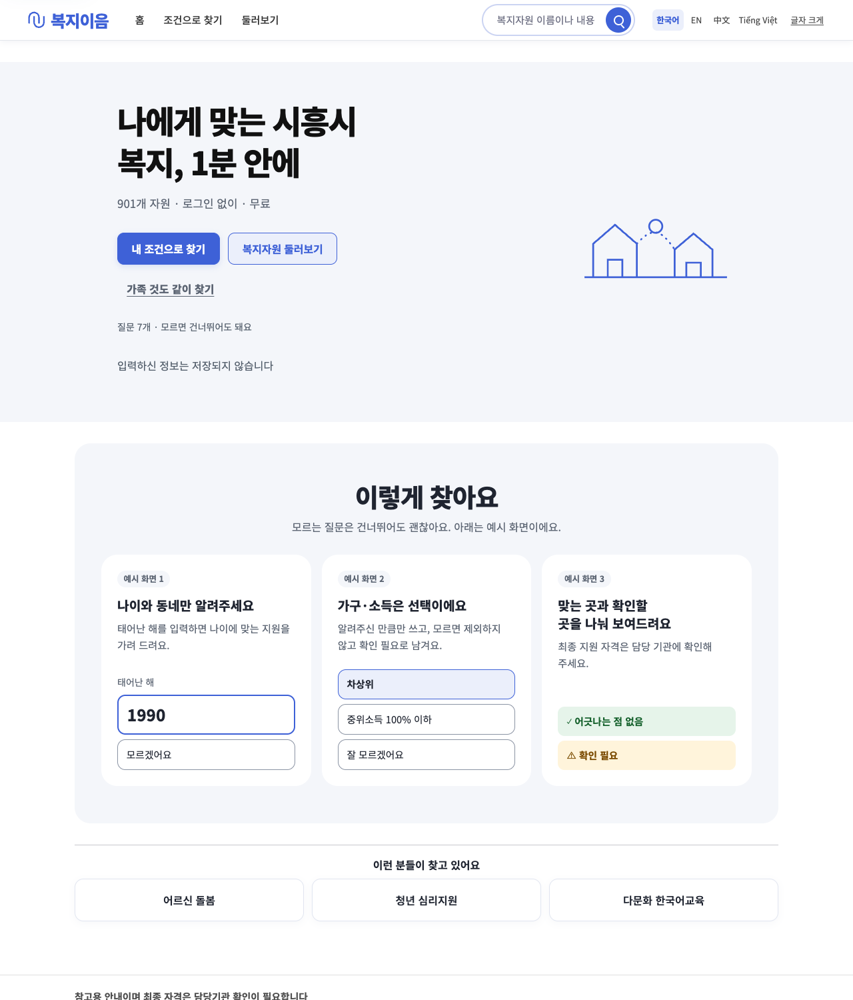
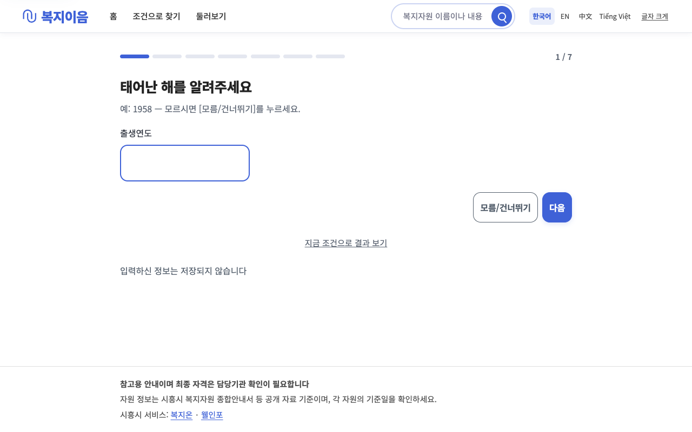
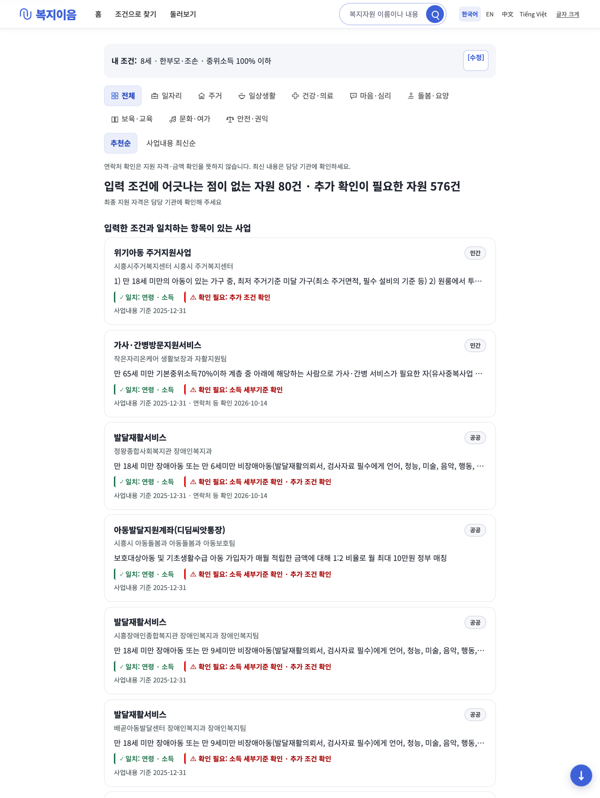
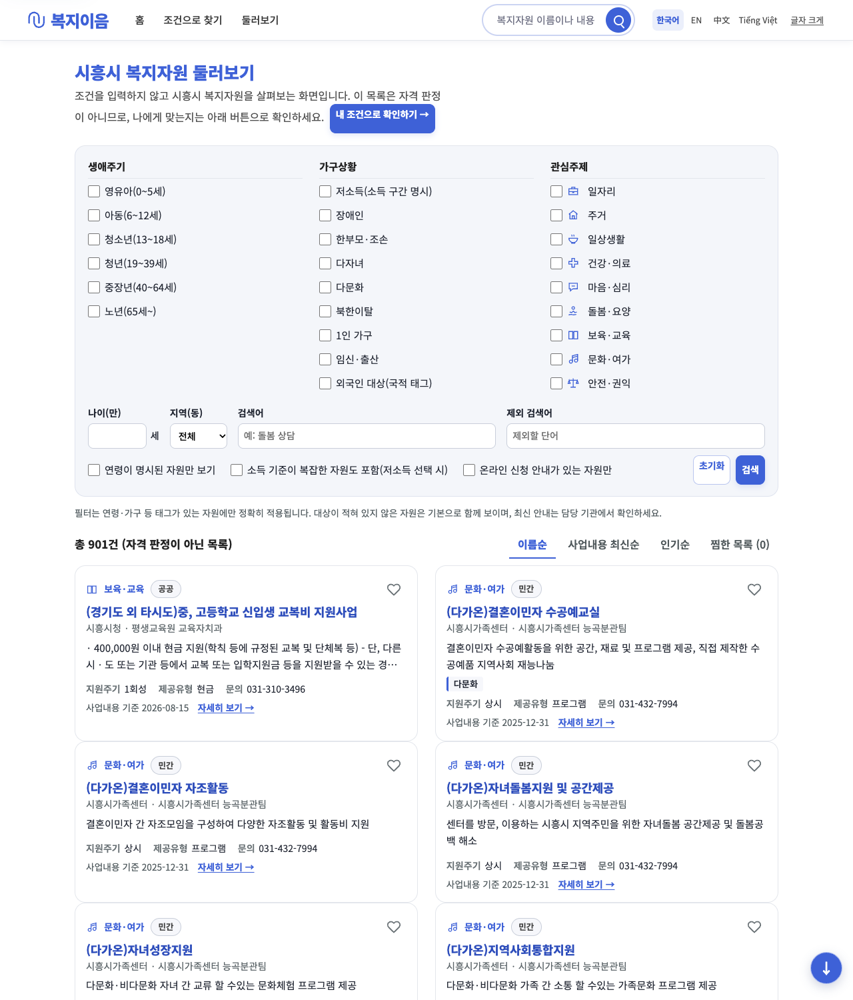
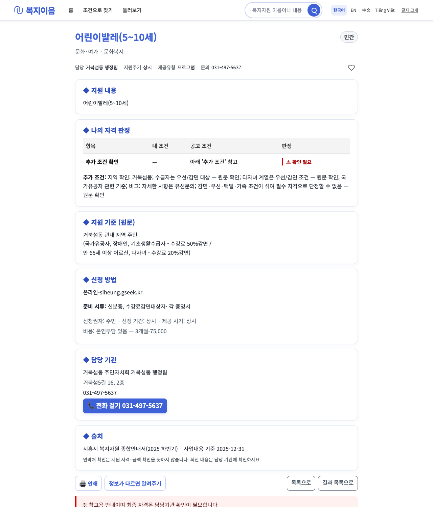

# 복지이음 (bokji-ieum)

> 시흥시 복지자원 **901건**(공공 471·민간 430)을 로그인 없이 **1분 조건 입력 → 규칙 기반 자격 판정 → 추천 이유와 신청 안내**로 이어 주는 웹 서비스.
> 웹서비스프로그래밍 팀 프로젝트 — 팀 **이음** (김재민·문재혁·이병화·이윤재) · CE 경진대회 출품작.

시흥시 복지자원을 조건별로 탐색하고, **매칭 근거(일치/확인 필요)와 신청 안내**를 확인하는 시범 서비스다. 명시 조건에 맞는 항목을 먼저 정렬하고 불확실한 항목도 '확인 필요'로 함께 보여 주므로, 대표 입력에서도 결과가 수백 건 남을 수 있다. 생성형 AI 없이 결정표 기반 규칙(SQL)만 사용해 같은 입력이면 같은 결과가 재현된다. 범위는 **시흥시 자원만**이다(중앙부처·전국 민간 데이터는 싣지 않는다).

## 화면 미리보기 (2025 하반기 안내서 데이터, 2026-11-25 촬영)

| 홈 | 조건 입력(7단계 중 1단계) |
|---|---|
|  |  |

| 맞춤 결과(8세·한부모·조손·중위소득 100% 이하 예시) | 둘러보기 |
|---|---|
|  |  |

| 자원 상세 | 모바일 홈 |
|---|---|
|  |  |

## 이번 변경 요약 — 자원 데이터를 2025 하반기 종합안내서로 전량 교체

기존 2022 하반기 종합안내서(744건) 기반 seed를 **2025 하반기 종합안내서 853건**(원본 854행에서 완전중복 1행 제외)으로 교체했다. 활성 자원은 **901건 = 안내서 853 + 복지로 API 24 + 보조금24 24**.

| 항목 | 변경 전 | 변경 후 |
|---|---|---|
| seed 원본 | 2022 하반기 종합안내서 744건 | 2025 하반기 종합안내서 853건(854행 − 완전중복 1) |
| 활성 자원 | 792건 (안내서 744 + API 24 + 보조금24 24) | **901건** (안내서 853 + API 24 + 보조금24 24) |
| 공공(PUB) / 민간(PRV) | 246 / 546 | **471 / 430** (안내서분만: 423 / 430) |
| 외국인 전용(F) | 15건 | **7건** (안내서 6 + 보조금24 1) |
| 안내서분 기준일 | 2022-12-31 | **2025-12-31** |
| 분류 | 원본 중분류 → 서비스 카테고리 9종 | 새 대분류 11종·중분류 36종 → 서비스 카테고리 9종(규칙 `CAT_RULE`) |
| 외국인 전용(F) 태깅 | 외국인 표기 위주 | **엄격화** — 내국인이 포함될 수 있으면 F를 달지 않고 '확인 필요' |
| resource_id | 1~744 + API/보조금24 745~792 | 안내서 **1001~1853**(2022판 id와 겹치지 않음 — 옛 찜·URL이 다른 사업을 가리키지 않게) + API/보조금24 1854~1901 |
| resource_id 고정 패치 5종 | 구 id 기준 | **서비스명+기관 일치만 새 id로 이관**(이름만 같은 행은 이관 안 함, 불가 문장은 제거). 시설현황 대조는 기관명·확인된 전화 일치 행만 재생성 |
| 자격 태그 | 문자열 규칙 그대로 | 감면·우선·택일·가족 구성원 문구가 있는 행(감면·우선·택일·나열형 대상자 등 171건)은 연령·소득·가구·장애·학업취업 태그 일부 또는 전부를 비우고 '확인 필요'로 표시 — 일반 이용자 오제외 방지 |
| 개인 연락처 | — | 휴대폰·이메일 형식 값은 게시하지 않음(17행 — 비고 포함, '담당기관 문의' 표시) |
| 영어 번역 샘플(`resource_i18n`) | 10건 | **1건**(새 안내서의 서비스명이 달라져 일치분만) |
| 담당자 성명·이메일 | — | **가져오지 않음**(원본 담당자 열 미사용, 저장소에 원본 xlsx 없음) |
| 2022판에만 있던 자원 | 포함 | 새 안내서에 이름이 없으면 **제외** |

안내서분 853건의 서비스 카테고리 분포(`seed.sql` 집계, `docs/데이터/수집/분류매핑-2025.csv` 합계와 일치):

| CULTURE | EDU | DAILY | HEALTH | CARE | MIND | JOB | HOUSE | RIGHTS |
|---|---|---|---|---|---|---|---|---|
| 182 | 166 | 120 | 110 | 97 | 63 | 55 | 37 | 23 |

- 분류 규칙·근거: [`docs/데이터/tools/parse_tag_2025.py`](docs/데이터/tools/parse_tag_2025.py)의 `CAT_RULE`, [분류매핑-2025.csv](docs/데이터/수집/분류매핑-2025.csv)
- id 이관 근거: [id이관-2025.csv](docs/데이터/수집/id이관-2025.csv), [시설현황대조-2025.csv](docs/데이터/수집/시설현황대조-2025.csv)
- 교체 판단 배경(이름 대조 311/744, id 패치 영향 등): [검증-2025안내서-20261125.md](docs/데이터/수집/검증-2025안내서-20261125.md)
- 생성 도구: `parse_tag_2025.py`(seed 생성)·`remap_ids_2025.py`(id 이관)·`gen_facility_2025.py`(시설 패치)

## 완성된 주요 기능

### 조건 입력과 맞춤 매칭 — `/match`, `/match/result`
- **7스텝 입력**: 출생연도·거주 동·가구 유형·소득 구분·장애·국적·학업/취업. 모든 스텝에서 [모름/건너뛰기]와 "지금 결과 보기"가 가능하고, 가구원을 추가해 가구원별 탭으로 매칭한다.
- **SQL 판정**: 판정 로직은 `resource-mapper.xml`의 `judgeWhere`(제외 조건)·`judgeCols`(항목별 일치/확인 필요 산출) 한 곳에 있다. 설계 근거는 [docs/설계/03](docs/설계/03-매칭-엔진-설계.md) 결정표.
- **원칙**: *"애매하면 확인 필요, 틀리게 제외 금지"*. 결과 카드에 ✅일치/⚠️확인 필요 태그(추천 이유), 입력 조건에 어긋나는 점이 없는 자원 수와 추가 확인이 필요한 자원 수의 분리 카운터, 분야 필터, '오래된 자료' 뱃지(기준일 경과)를 보여 준다.
- 외국인을 선택하면 외국인 대상 자원을 우선 정렬한다. 입력은 서버 세션에만 두고 별도 저장하지 않는다.

### 자원 탐색 — `/resources`
- 조건 입력 없이 분야(카테고리 9종)·생애주기·가구상황 체크, 나이·동, 검색어(공백 구분 AND)·제외 검색어, 온라인 신청 필터, 정렬(이름순·최신 기준일순·인기순)과 쪽 이동. 자격 판정이 아닌 목록이며 계약은 [docs/설계/07-탐색모드.md](docs/설계/07-탐색모드.md).
- **찜**: 브라우저 `localStorage`에만 저장(회원 기능 아님, 최대 50건). 찜 목록 보기만 `ids` 쿼리로 서버에 보내며 서버는 활성 자원 ID만 통과시킨다.

### 상세 — `/resources/{id}`
- 입력 조건이 있으면 **판정표**(내 조건 vs 공고 조건, 항목별 일치/확인 필요/불일치). 표시용 문구는 `JudgeCompare`가 만들고 판정은 SQL 태그를 그대로 쓴다.
- 신청 방법·서류·연락처(`tel:` 링크)·출처·기준일, 인쇄, **오류 제보**(`POST /reports`, 토큰·요청 한도 적용).

### 다국어·접근성·화면
- **4개 언어**: 한국어·English·中文·Tiếng Việt (`messages_{ko,en,zh,vi}.properties`). 화면 문구는 기계번역 초벌이며 자원 본문 번역은 en 3건뿐(zh/vi 본문은 한국어).
- 글자 크게 토글, 움직임 줄이기 존중, 공개 화면 `aria-label` 다국어화, 대비 AA 측정 스크립트(`docs/검증/contrast-check.js`), 390px 모바일 폭 대응. 토스식 흰 바탕 UI(홈 CTA·"이렇게 찾아요" 섹션·가벼운 카드).

### 관리자 — `/admin/login`
- 자원 목록·검색·기준일 경과 필터, 등록·수정(`/admin/resources`, `/new`, `/{id}/edit`), 상태(활성/비활성) 전환 — **수정 즉시 매칭에 반영**, 변경 이력(`resource_history`) 자동 기록.
- 오류 제보 처리(`/admin/reports`: 접수→확인→반영).
- 비로그인 차단·CSRF 검증. 초기 계정은 환경변수로만 생성(고정 비밀번호 없음).

### 익명 퍼널 로그
- 매칭→상세→전화/신청→제보 이벤트를 `match_log`·`event_log` 테이블에 기록(식별자 미저장, 10세 연령 밴드·세션 해시). **관리자 통계 화면은 없다**(DB 조회로만 확인).

## 기술 스택

JSP/JSTL · Spring MVC 5.3 (**비-Boot**, web.xml) · MyBatis 3.5 · MySQL 8 (Docker) · Tomcat 9 (cargo 플러그인) · Bootstrap 5.3 · JDK 17(`maven.compiler.release=17`).

## 빠른 시작 (JDK 17 + Docker만 있으면 됨, Maven 설치 불필요)

```bash
git clone <repo-url> && cd bokji-ieum
docker compose up -d                                   # MySQL 8 기동 + 스키마·데이터 자동 적재(최초 1회, 1~2분)
docker logs -f bokji-mysql                             # "[bokji] 적재 완료: 활성 자원 901건"이 보이면 끝
cp src/main/resources/config.properties.example src/main/resources/config.properties
./mvnw cargo:run                                       # http://localhost:8080  (Windows: mvnw.cmd)
```

- 빈 볼륨에서 `docker/initdb/01-load-data.sh`가 `schema → seed → api-update → facility-refresh → gov24-update → reliability-tagging → reliability-provenance → address-typo-fix → apply-url-fix → content-i18n` 순서로 적재한다. 기대 건수 **901**. 다시 적재: `docker compose down -v && docker compose up -d`(**볼륨 삭제 = DB 초기화 — 버려도 되는 로컬 DB에서만**, 기존 데이터가 있는 DB는 백업 후 [SETUP.md](SETUP.md) 안내를 따를 것). 2022판(792건) DB를 쓰던 환경은 id 대역이 바뀌어 옛 찜·URL이 '없는 자원'이 된다.
- `config.properties`는 gitignore 대상이다. 실제 DB 비밀번호·공공데이터 `serviceKey`를 쓸 때는 이 파일에만 적고 **커밋하지 않는다**.
- 관리자: `/admin/login` — 첫 기동 시 환경변수 `BOKJI_ADMIN_INITIAL_PASSWORD`가 있으면 `admin` 계정을 그 값으로 생성한다(값이 없으면 만들지 않고, 기존 계정은 바꾸지 않음). 예: `BOKJI_ADMIN_INITIAL_PASSWORD=<임의값> ./mvnw cargo:run`
- 상세 절차·문제 해결: [SETUP.md](SETUP.md) · 발표 시연 순서: [docs/데모.md](docs/데모.md)

## 검증

| 항목 | 방법 |
|---|---|
| 데이터 게이트 | `docs/검증/data-gate.sh` — 격리 MySQL 컨테이너에 빈 DB 적재 → 보정 SQL 멱등 → 고정 수치·핵심 행 단언 |
| 회귀 스크립트 | `docs/검증/`의 `match-regression.py`(매칭 엔진)·`resource-search-regression.py`(탐색 계약)·`compare-regression.py`(판정표)·`age-hint-regression.py`·`link-regression.py`·`persona-scenarios.py`·`ledger-check.py`, `contrast-check.js`(대비) |
| 단위 테스트 | `./mvnw -q test` (현재 `AdminInitializerTest`) · 결정표 단위 케이스는 [docs/검증/단위케이스.md](docs/검증/단위케이스.md) |

- 2022판 시점(792건)에 수행한 결정표 단위 케이스 40/40·시나리오 S1~S6·통합 스모크(XSS·CSRF·제보 한도·비로그인 차단) 기록은 [docs/검증/](docs/검증/)에 있다. **이 기록은 데이터 교체 전 수치이며 규칙 구현 확인일 뿐 실제 자격 정확도·901건 전체 정답률 측정이 아니다.**
- 이번 교체의 수치(활성 901 / PUB 471 / PRV 430 / F 7, F전용 제외 노출 894)는 `docs/검증/data-gate.sh`와 회귀 스크립트 6종(매칭·탐색·판정표·연령힌트·링크·대장)이 빈 DB 적재부터 실제 앱(HTTP)까지 통과한 값이다. 2022판 시점 문서의 792 등은 당시 값이다.
- 2022판에만 있던 자원 목록: [2022판-제외목록-20261125.csv](docs/데이터/수집/2022판-제외목록-20261125.csv)(새 목록에 이름 없음 431·동명이나 기관 상이 100) — 종료·개편·명칭 변경 여부는 확인되지 않았다.
- Codex 리뷰·스모크 기록: [reviews/](reviews/)

## 문서 구성

| 경로 | 내용 |
|---|---|
| [docs/설계/](docs/설계/) | 설계서 00~07 (개요·아키텍처·DB·매칭 엔진·URL/화면·검증 운영·팀 운영·탐색 모드) |
| [docs/데이터/](docs/데이터/) | 태깅 현황·미결, 수집 근거 CSV·로그, 공공데이터 API 명세, 태깅·교체 스크립트 |
| [docs/검증/](docs/검증/) | 단위 케이스·fixtures·회귀 스크립트·스모크 raw 로그 |
| [docs/데모.md](docs/데모.md) | 발표 데모 시연 경로 (데이터 교체 전 작성분 — 수치는 갱신 전) |

## 알려진 한계와 사람이 할 일

- **배포는 한 번도 하지 않았다.** 로컬 실행(Docker + cargo)만 확인했다.
- 안내서분 기준일 2025-12-31은 **원본 파일 기준**이다. 사업별 본문을 개별 대조한 것이 아니며, 최신성은 자원별 기준일로 확인해야 한다. 2022판에만 있던 자원 중 새 안내서에 이름이 없는 것은 제외했는데, 이름 변경 가능성은 사람이 대조해야 한다.
- 복지로 API·보조금24·시설현황 3종 대조(24건 추가, 연락처 등 수정)는 2026-10-14 일회성이며 자동 동기화는 없다.
- 자원 본문 번역은 en 3건뿐이고 zh/vi 본문은 한국어다. 성별 전용 조건은 '확인 필요'로만 표시한다.
- 사용성 효과(탐색 시간 단축·퍼널 도달률·설문)는 **미측정**이다. 사용성 테스트는 아직 하지 않았다.
- 원본 xlsx에는 담당자 성명·이메일 열과 일부 개인 연락처 형식 값이 있다. 원본은 저장소에 올리지 않았고, 연락처·신청방법 열의 개인 번호 여부는 공개 전 사람이 확인해야 한다.
- 시흥시 복지정책과에 **종합안내서 최신판·사업 종료/개편 여부 공문 요청**은 사람이 진행해야 한다(시 부서의 운영 수락·최신본 제공은 미확인).
- 미구현: 회원 로그인, 서버 저장 즐겨찾기, 자원 간 나란히 비교, 뉴스 수집, 관리자 통계, 복지로 자동 주간 동기화.
